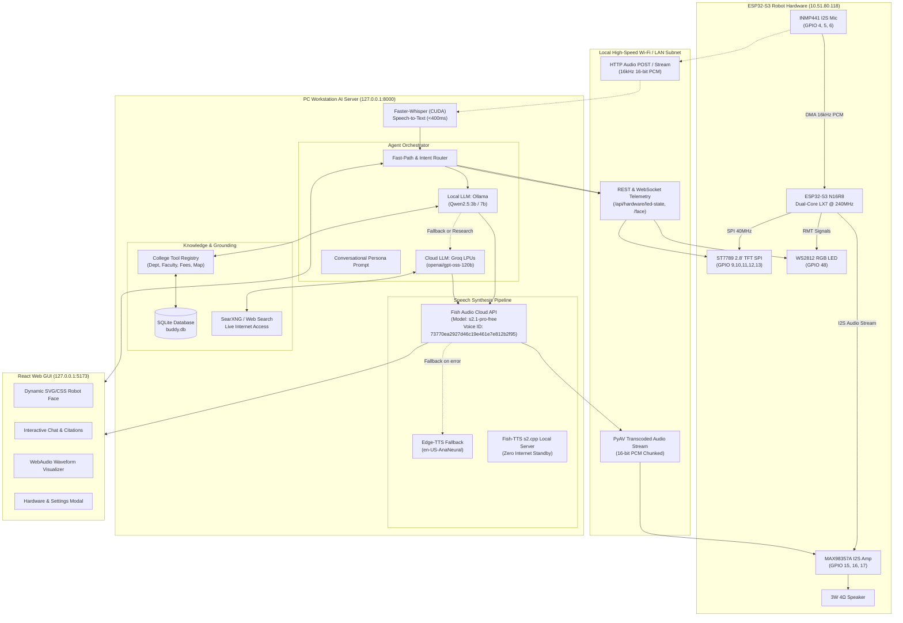

# BUDDY AI — COMPLETE PROJECT MASTER CONTEXT SPECIFICATION

> **Project Name:** BUDDY — Smart AI College Reception Robot  
> **Deployment Site:** Anantrao Pawar College of Engineering & Research (APCOER), Pune, Maharashtra, India  
> **Parent Trust:** Akhil Bharatiya Maratha Shikshan Parishad (A.B.M.S. Parishad, Estd. 1907)  
> **Target Version:** 2.0 (Hybrid Local-Cloud AI + ESP32-S3 Physical Hardware Integration)  
> **Generated Context File:** `prompt/Output/Context.md`  
> **Last Updated:** October 2026  

---

## 1. EXECUTIVE SUMMARY & INSTITUTIONAL IDENTITY

### 1.1 Project Purpose
BUDDY is an autonomous, bilingual-capable, multimodal AI-powered physical receptionist robot designed for permanent deployment at the main entrance welcome lobby of **Anantrao Pawar College of Engineering & Research (APCOER)** in Parvati, Pune. 

Stationed at the reception counter, BUDDY acts as the first point of contact for prospective students, parents, visiting dignitaries, corporate recruiters, and current campus students. The robot combines:
1. **Interactive Conversational Intelligence:** Answers academic inquiries, admission requirements, fee structures, faculty locations, and campus directions in warm, natural spoken human dialogue.
2. **Dynamic Live Research:** Searches the live internet and APCOER digital documentation for real-time schedule updates, world news, university circulars (SPPU/DTE), and external inquiries.
3. **Multimodal Presence:** Renders synchronized facial expressions on both a high-definition web console and an onboard 2.8" SPI TFT LCD screen, accompanied by an intelligent 8-state WS2812 RGB LED signaling system.
4. **Physical IoT Hardware:** An ESP32-S3 microcontroller operating custom firmware that handles I²S digital audio capture (INMP441 microphone), I²S Class-D speaker amplification (MAX98357A), SPI display graphics, and wireless telemetry over Wi-Fi.

---

### 1.2 Institutional Identity & Ground Truth Facts
All conversational dialogue emitted by BUDDY is strictly grounded in the following official historical and institutional facts:

- **College Name:** Anantrao Pawar College of Engineering & Research (APCOER), Pune.
- **Year of Establishment:** 2012.
- **Affiliation & Approvals:** Approved by AICTE New Delhi, Recognized by Directorate of Technical Education (DTE) Maharashtra, and Affiliated to Savitribai Phule Pune University (SPPU). NAAC Accredited.
- **DTE Institute Code:** 6794.
- **Parent Educational Society:** Akhil Bharatiya Maratha Shikshan Parishad (A.B.M.S. Parishad).
  - *Year Founded:* 1907 (over 118 years of educational service).
  - *Guiding Motto:* *"Bahujan Hitay, Bahujan Sukhaya"* (For the welfare and happiness of the masses).
  - *Heritage & Philosophy:* In the early 20th century, A.B.M.S. Parishad led a historic social transformation in Maharashtra by establishing accessible educational institutions for communities historically deprived of schooling.
  - *Foundational Inspirations:* Mahatma Jyotirao Phule, Rajarshi Chhatrapati Shahu Maharaj (Ruler of Kolhapur), and Bharat Ratna Dr. Babasaheb Ambedkar.
  - *Trust Leadership:* Hon. Sharadchandraji Pawar (President, ABMSP), Mrs. Pramila Gaikwad (General Secretary, ABMSP).
- **College Leadership:**
  - *Principal:* Dr. Sunita M. Patil.
  - *Vice Principal:* Dr. Raviraj Ramesh Sorate.
- **Academic Departments & Leadership:**
  1. *Information Technology (IT):* Headed by Dr. Amit Ashokrao Kadam (Cabin: Room 304, 3rd Floor, Main Academic Building). Contact: `amit.kadam@abmspcoerpune.org`. Focus on Blockchain, Cloud Computing, Full-Stack Development, and Cybersecurity.
  2. *Computer Engineering:* Headed by Dr. Rama B. Gaikwad. Specializes in Artificial Intelligence, High-Performance Computing, and Distributed Systems.
  3. *Artificial Intelligence & Data Science (AI & DS):* Headed by Dr. Jitendra Musale. Focus on Machine Learning, Big Data Analytics, Neural Networks, and Predictive Modeling.
  4. *Electronics & Telecommunication Engineering (E&TC):* Headed by Dr. Amar Deshmukh (Cabin: Room 323). Focus on VLSI Design, Embedded Systems, IoT, and Signal Processing.
  5. *Civil Engineering:* Headed by Dr. Raviraj Ramesh Sorate (Cabin: Room 224, NBA Coordinator). Focus on Structural Engineering, Environmental Engineering, and Sustainable Infrastructure.
  6. *Mechanical Engineering:* Headed by Dr. Dattatray P. Kamble. Focus on CAD/CAM, Thermal Systems, Mechatronics, and Robotics.
  7. *Master of Computer Applications (MCA):* Headed by Dr. Atul D. Newase. Focus on Software Architecture, Enterprise Systems, and Mobile Application Development.
  8. *First Year Engineering / Applied Science:* Headed by Dr. Balaji S. Selukar.
- **Training & Placement Cell (TPO):**
  - Headed by Prof. Nilesh S. Totla (Cabin: Room TPO-01).
  - *Key Recruiters:* Tata Consultancy Services (TCS), Infosys, Capgemini, L&T Infotech, Tech Mahindra, Cognizant, Bosch, Persistent Systems, and Hexaware.
- **Campus Facilities:**
  - *Central Library & Digital Reading Hall:* Ground and 1st Floors, housing over 25,000+ technical volumes, national/international journals, and IEEE digital access.
  - *APCOER TBI:* Technology Business Incubator & Innovation Centre supporting student startups and patent drafting.
  - *Facilities:* 400-seater air-conditioned Auditorium, Gymnasium & Sports Grounds, Hygienic Canteen, Boys & Girls Hostels, Seminar Halls on each departmental floor.
- **Flagship Annual Events:**
  - *SPARKTECH:* National-level technical symposium featuring paper presentations, robotics challenges, and coding competitions.
  - *Technothon:* 24-hour inter-college hackathon and innovation marathon.
  - *Ashwamedh:* Annual college sports, drama, and cultural festival.

---

## 2. HIGH-LEVEL SYSTEM ARCHITECTURE & DATAFLOW

BUDDY utilizes a distributed two-tier architecture:
1. **Tier 1 — Host AI Brain (Windows Workstation / Local Edge Server):** Executes heavy neural network inference, orchestration, speech recognition, tool execution, knowledge base queries, and neural audio synthesis.
2. **Tier 2 — Robot Physical Interface (ESP32-S3 IoT Microcontroller):** Mounts directly onto the physical robot body, driving the 2.8" TFT display face, WS2812 RGB status ring, I²S MEMS microphone, and I²S audio power amplifier.



---

## 3. HARDWARE SPECIFICATION & PIN CONFIGURATION

### 3.1 Board Specifications
- **Development Board:** ESP32-S3 N16R8 Dev Module.
- **Processor:** Dual-Core 32-bit Xtensa LX7 running at 240 MHz.
- **Flash Memory:** 16 MB Quad/Octal SPI Flash.
- **PSRAM:** 8 MB Octal PSRAM (OPI).
- **USB Interface:** Dual USB-C ports (one Native USB CDC/JTAG port, one CP2102/CH340 hardware UART COM port).

### 3.2 Safety Rules & Forbidden Pin Zones
Because the **N16R8** variant utilizes 8MB Octal PSRAM and 16MB SPI Flash, internal high-speed lines occupy specific pins. 

> [!CAUTION]
> **STRICT FORBIDDEN PINS (CRASH & PERMANENT HARDWARE DAMAGE RISK):**
> - **GPIO 26, 27, 28, 29, 30, 31, 32:** Connected internally to the Flash memory die.
> - **GPIO 33, 34, 35, 36, 37:** Connected internally to the Octal PSRAM data lines and clock.
> *Connecting any external wire or sensor to GPIO 26–37 will instantly crash the ESP32-S3 and can permanently destroy the PSRAM chip.*

> [!WARNING]
> **STRAPPING & BOOT PINS (DO NOT PULL HIGH/LOW EXTERNALLY):**
> - **GPIO 19 & GPIO 20:** Native USB D- and D+ lines.
> - **GPIO 0:** Boot ROM strap pin (must be HIGH during normal boot).
> - **GPIO 45:** VDD_SPI internal voltage strap pin.
> - **GPIO 46:** Boot ROM strapping pin (must remain LOW at boot).

---

### 3.3 Conflict-Free Master Pin Allocation Table

| Peripheral | Signal Pin | ESP32-S3 Pin | Signal Direction | Operating Voltage | Function & Hardware Notes |
| :--- | :--- | :---: | :---: | :---: | :--- |
| **Onboard WS2812** | DIN | **GPIO 48** | Output | 3.3V Logic | Built-in RGB status LED. Verified via `rgbLedWrite(48, R, G, B)`. |
| **ST7789 2.8" LCD** | SCL / SCK | **GPIO 12** | Output | 3.3V Logic | Hardware SPI Master Clock (up to 40 MHz). |
| **ST7789 2.8" LCD** | SDA / MOSI | **GPIO 11** | Output | 3.3V Logic | Hardware SPI Master Out Slave In pixel stream. |
| **ST7789 2.8" LCD** | CS | **GPIO 10** | Output | 3.3V Logic | Chip Select (active LOW). Tie to GND if 7-pin display module. |
| **ST7789 2.8" LCD** | DC | **GPIO 9** | Output | 3.3V Logic | Data / Command register control. |
| **ST7789 2.8" LCD** | RES / RST | **GPIO 13** | Output | 3.3V Logic | Hardware Reset line (active LOW). |
| **ST7789 2.8" LCD** | BLK / BL | **GPIO 14** | Output | 3.3V Logic | PWM Backlight brightness control (or bridge to 3.3V). |
| **INMP441 Mic** | SCK / BCLK | **GPIO 4** | Output | 3.3V Logic | I²S Controller 0 Bit Clock for microphone input. |
| **INMP441 Mic** | WS / LRC | **GPIO 5** | Output | 3.3V Logic | I²S Controller 0 Word Select (Left/Right Clock). |
| **INMP441 Mic** | SD / DOUT | **GPIO 6** | Input | 3.3V Logic | I²S Controller 0 Serial Data stream (24-bit/16-bit PCM). |
| **INMP441 Mic** | L/R | GND | Input | 0V | Tied to GND to select Left Channel audio. |
| **MAX98357A Amp** | BCLK | **GPIO 15** | Output | 3.3V Logic | I²S Controller 1 Bit Clock for audio speaker output. |
| **MAX98357A Amp** | LRC / WS | **GPIO 16** | Output | 3.3V Logic | I²S Controller 1 Left-Right Frame Clock. |
| **MAX98357A Amp** | DIN | **GPIO 17** | Output | 3.3V Logic | I²S Controller 1 Digital audio stream to Class-D DAC. |
| **MAX98357A Amp** | GAIN | GND / Open | Input | 0V | Unconnected = 9dB gain; GND = 3dB; 100kΩ = 15dB. |
| **Push Button** | KEY | **GPIO 0** | Input | 3.3V Pullup | Hardware Boot / Push-to-Talk button. |
| **Auxiliary Button** | AUX | **GPIO 1** | Input | 3.3V Pullup | Hardware Mute / Volume toggle button. |

---

### 3.4 Dual-Controller I²S Architectural Advantage
Unlike simpler ESP32 microcontrollers with a shared I²S engine, the ESP32-S3 provides **two completely independent I²S hardware controllers**:
- **I²S Controller 0 (RX on GPIO 4, 5, 6):** Configured exclusively in Master Receive mode at **16,000 Hz, 16-bit Mono** for optimal Whisper STT accuracy.
- **I²S Controller 1 (TX on GPIO 15, 16, 17):** Configured exclusively in Master Transmit mode at **24,000 Hz / 44,100 Hz, 16-bit Stereo/Mono** for high-fidelity speech synthesis playback.

**Benefits:**
1. **Zero Sample-Rate Conflict:** The microphone does not need to pause or reconfigure when speech audio streams into the speaker.
2. **Full-Duplex Interruption:** Enables continuous wake-word listening and barge-in capability (allowing the user to say *"Buddy, stop"* while the robot is speaking).

---

### 3.5 Electrical Power Rails & Decoupling Scheme

```
[ PC USB-C Port / 5V 2.5A Supply ]
      │
      ├───────────────────────────────────► [ 5V VBUS Rail ]
      │                                             │
      │                                             ├──► [ MAX98357A Amp VDD ] (Draws 300mA - 800mA dynamic peak)
      │                                             │
      │                                      [ 100µF Electrolytic + 10µF Ceramic ] (Audio Decoupling)
      │
      ▼
[ Onboard 3.3V LDO Regulator ]
      │
      └───────────────────────────────────► [ 3.3V Logic Rail ]
                                                    │
                                                    ├──► [ ESP32-S3 Core & Wi-Fi ] (~160mA - 350mA)
                                                    ├──► [ ST7789 2.8" LCD Logic ] (~40mA - 85mA)
                                                    ├──► [ INMP441 Microphone VDD ] (~1.4mA)
                                                    └──► [ WS2812 RGB LED VDD ] (~20mA)
```

**Critical Grounding & Power Rules:**
1. **Never power the MAX98357A from the 3.3V pin:** Driving a 3W 4Ω speaker from the onboard 3.3V regulator causes voltage brownouts, resetting the ESP32 Wi-Fi radio every time loud speech is synthesized.
2. **Decoupling Capacitors:** Place a **100µF electrolytic capacitor** in parallel with a **10µF ceramic capacitor** across the `5V` and `GND` pins directly at the MAX98357A amplifier terminals. This eliminates the high-frequency switching noise of the Class-D amp and prevents buzzing.
3. **Common Star Ground:** All ground lines (ESP32 `GND`, Amp `GND`, Mic `GND`, Display `GND`) must return to a single common ground junction.

---

## 4. BACKEND ARCHITECTURE & COMPONENT DIRECTORY

The backend is written in **Python 3.10+** using **FastAPI** and **Uvicorn**, structured with clear separation of concerns:

```
backend/
├── app/
│   ├── main.py                     # Application entry point, CORS, lifespan, router mounting
│   ├── config.py                   # Pydantic BaseSettings loading .env configuration
│   ├── agent/                      # Conversational intelligence engine
│   │   ├── orchestrator.py         # Multi-turn dialog manager, fallback routing, session history
│   │   ├── prompts.py              # System prompt, persona, institutional rules, phonetics
│   │   ├── fast_path.py            # Sub-10ms deterministic intent resolution for common queries
│   │   └── tool_registry.py        # OpenAI/Ollama function calling schema & tool dispatchers
│   ├── database/                   # SQLite persistence & APCOER college repository
│   │   ├── models.py               # Pydantic data schemas (Department, Faculty, FAQ, Citations)
│   │   ├── repository.py           # SQL queries, FTS full-text search, lookup methods
│   │   └── seed.py                 # Ground-truth dataset seeding for all APCOER departments
│   ├── services/                   # External model & cloud integrations
│   │   ├── ollama_service.py       # Local LLM integration (Qwen2.5:3b via HTTP)
│   │   ├── groq_service.py         # High-speed cloud reasoning (openai/gpt-oss-120b)
│   │   └── searxng_service.py      # Metasearch engine connector for web questions
│   ├── voice/                      # Audio processing pipeline
│   │   ├── transcription.py        # Faster-Whisper CUDA speech-to-text service
│   │   └── synthesis.py            # Multi-engine TTS (Fish Audio API, Edge-TTS, Local S2)
│   ├── hardware/                   # Physical ESP32 hardware bridge
│   │   ├── esp32_client.py         # PyAV streaming audio decoder & HTTP state dispatcher
│   │   └── routes.py               # Hardware REST endpoints (/api/hardware/led-state, /status)
│   ├── api/                        # REST & WebSocket API endpoints
│   │   ├── routes_chat.py          # /api/chat, /api/chat/stream, session management
│   │   ├── routes_voice.py         # /api/voice/transcribe, /api/voice/synthesize, /audio/{file}
│   │   ├── routes_admin.py         # Knowledge base CRUD, document ingestion, system diagnostics
│   │   └── routes_config.py        # Live settings inspection & configuration mutations
│   └── security/                   # Authentication & token verification for admin routes
```

---

### 4.1 Orchestrator & Conversational Intelligence (`agent/orchestrator.py`)
- **Session Manager:** Tracks multi-turn conversational history in isolated sessions (up to 15 turns), maintaining the system prompt anchored at index 0 while sliding older turns out of memory.
- **Fast-Path Intent Classifier:** For trivial or repetitive queries (*"Where is the IT department?", "Who is the principal?"*), the system bypasses LLM inference entirely to deliver an instantaneous response in `<10ms` with zero compute overhead.
- **Hybrid Multi-Model Router:**
  1. *Primary Brain (Local Ollama):* Calls local `qwen2.5:3b` on `http://localhost:11434`. Executes tool-calling loops (up to 5 iterations) for department and faculty lookups.
  2. *Secondary Cloud Brain (Groq LPUs):* When complex external reasoning, live internet news, or deep world knowledge is requested, or if Ollama is offline/unresponsive, the system seamlessly escalates to Groq's high-speed `openai/gpt-oss-120b` (with automated fallback to `qwen/qwen3.8-27b`).
  3. *Strict Schema Serialization:* Serializes all nested `tool_calls.function.arguments` into valid JSON strings before submitting to Groq, preventing schema rejection errors.

---

### 4.2 Conversational Persona & Dialogue Rules (`agent/prompts.py`)
1. **Spoken Dialogue vs Chatbot Text:**
   - *Forbidden:* Bullet points (`•`, `-`, `*`), bold markdown tags (`**Name:**`), markdown tables, database ID codes, or phrases like *"According to the database..."*.
   - *Mandatory:* Spoken natural dialogue as if standing face-to-face with a visitor. Weaves names, cabin room numbers, and floor levels directly into melodious sentences.
2. **Initialism & Acronym Phonetic Rule:**
   - *Rule:* Acronyms like **APCOER** must **NEVER** be pronounced as a single combined word (*"App-core"* or *"Ap-co-er"*).
   - *Requirement:* All occurrences are spaced as individual uppercase letters `"A, P, C, O, E, R"` so the text-to-speech synthesizer reads each letter individually. The same rule applies to `A, B, M, S, P`, `S, P, P, U`, `D, T, E`, `H, O, D`, and `T, P, O`.
3. **Closing Engagement:**
   - Every answer concludes with a warm, courteous question (*"Would you like me to guide you to Room 304?", "Are you planning to take admission in engineering this year?"*).

---

### 4.3 Voice Processing Subsystems

#### Speech Recognition (`voice/transcription.py`)
- **Engine:** `faster-whisper` (CTranslate2 optimized Whisper implementation).
- **Device:** Accelerated on NVIDIA CUDA GPU (falls back to multi-threaded CPU int8 if CUDA unavailable).
- **Acoustic Processing:** 16,000 Hz, 16-bit mono PCM.
- **Features:** Voice Activity Detection (VAD) filter with 300ms silence cut-off, beam size 5, temperature 0.0 for deterministic accuracy.
- **Latency:** `<350ms` for average 5-second voice queries.

#### Speech Synthesis (`voice/synthesis.py`)
- **Primary Engine — Fish Audio Cloud API:**
  - *Endpoint:* `https://api.fish.audio/v1/tts`
  - *Model:* `s2.1-pro-free`
  - *Locked Reference ID:* **`73770ea2927d46c19e461e7e812b2f95`** (Permanently locks vocal timbre, pitch, and prosody across all requests to prevent voice drifting).
  - *Audio Format:* 44,100 Hz, 16-bit Mono MP3.
  - *Latency:* 1.6s – 3.8s (Real-Time Factor: 0.56x – 0.74x).
- **Secondary Engine — Edge-TTS Neural Fallback:**
  - *Voice:* `en-US-AnaNeural` (high-quality child-like cheerful female voice).
  - *Latency:* 1.2s – 1.8s.
  - Automatically invoked if Fish Audio Cloud API experiences network timeouts, quota limits, or outages.
- **Tertiary Engine — Local Fish-TTS Server:**
  - Connects to standalone C++ `s2.cpp` server on `http://127.0.0.1:3030` when operating in completely offline environments.

---

### 4.4 Hardware Bridge & Audio Streaming (`hardware/esp32_client.py`)
The PC server acts as an active streaming audio transmitter to the ESP32:
1. When audio is generated (MP3 format from Fish Audio or Edge-TTS), the server opens a PyAV decoding container.
2. PyAV resamples and transcodes the audio into **raw 16-bit signed PCM** at the speaker's target rate (24,000 Hz or 44,100 Hz).
3. The server pushes raw PCM audio chunks over HTTP POST to `http://10.51.80.118/audio/stream`.
4. The ESP32 receives chunks into a ring buffer and writes directly into I²S DMA channels, outputting crisp sound without popping or jitter.

---

## 5. FRONTEND WEB APPLICATION SPECIFICATION

Built with **React 18**, **TypeScript**, and **Vite** (`frontend/src/`):

```
frontend/src/
├── main.tsx                        # Application mount & root render
├── App.tsx                         # Core layout, state synchronization, audio listeners
├── index.css                       # Design tokens, color palette, animations
├── App.css                         # Layout grid, responsive styling
├── components/
│   ├── RobotFace.tsx               # Expressive animated robot avatar
│   ├── RobotEyes.tsx               # SVG rendered eyes with blink & tracking physics
│   ├── RobotMouth.tsx              # Audio-reactive talking mouth shapes
│   ├── ListeningWaveform.tsx       # Real-time Web Audio API frequency visualizer
│   ├── ConversationPanel.tsx       # Message list, citations, collapsible tool inspectors
│   ├── VoiceControls.tsx           # Push-to-talk, mic switch, mute, audio volume
│   ├── SettingsPanel.tsx           # Interactive modal for AI, TTS, & ESP32 configuration
│   ├── AdminPanel.tsx              # Knowledge base management, department CRUD, logs
│   └── StatusIndicator.tsx         # Real-time ping badges for Ollama, Groq, Whisper, ESP32
```

### 5.1 Animated Face System & State Engine
The frontend renders an animated vector robot avatar that mirrors the physical robot's ST7789 screen:
- **Idle:** Gentle procedural eye blinks every 3.5 seconds, subtle breathing pupil dilation, neutral smiling curved mouth.
- **Listening:** Eyes widen by 15%, pupils dial toward the center, animated soundwave ripples underneath the chin.
- **Thinking:** Eyes glance upward to the top-right, eyebrows slant, pulsing animated thinking dots rotate below.
- **Speaking:** Audio frequency data driven by the Web Audio API modulates the mouth height and width in real-time, creating lip-syncing.
- **Happy / Welcoming:** Eyes curve into inverted arcs (crescent moon eyes), wide smiling mouth.
- **Confused / Error:** One eye raises higher than the other, mouth forms a zig-zag wavy line.

---

## 6. ESP32-S3 EMBEDDED FIRMWARE SPECIFICATION

The firmware is located in `firmware/buddy_esp32/` and written in C++ for the Arduino-ESP32 framework:

```
firmware/buddy_esp32/
├── buddy_esp32.ino                 # Main entry point (setup and loop)
├── config.h                        # Master pin mappings, network parameters, audio buffers
├── display_manager.h / .cpp        # ST7789 SPI LCD driver, vector face drawing engine
├── microphone_manager.h / .cpp     # I2S0 DMA microphone recording & streaming
├── audio_output.h / .cpp           # I2S1 DMA audio playback to MAX98357A amplifier
├── rgb_manager.h / .cpp            # Non-blocking WS2812 RGB LED pattern engine (GPIO 48)
└── wifi_manager.h / .cpp           # Wi-Fi auto-reconnection, mDNS, embedded REST server
```

---

### 6.1 State Synchronization Matrix across All Subsystems

| Robot State | LCD Screen Face | Onboard WS2812 LED (GPIO 48) | Web Browser Face | Audio Activity | Trigger Source |
| :--- | :--- | :--- | :--- | :--- | :--- |
| **BOOTING** | APCOER Splash Logo | Pulsing Cyan (`#00FFFF`) | Loading Spinner | Silent | Power on / Reset |
| **IDLE** | Calm Eyes, Blinking, Gentle Smile | Breathing Soft Blue (`#0066FF`) | Idle Eyes & Pupil Drift | Silent | No interaction |
| **LISTENING** | Wide Attentive Eyes | Pulsing Vibrant Green (`#00FF44`) | Expanded Eyes + Waveform | Mic recording active | User speaking / Mic open |
| **THINKING** | Eyes Tilted Upward + Dots | Shimmering Gold/Amber (`#FFAA00`)| Thinking Head Tilt | Processing | LLM / Tool execution |
| **SPEAKING** | Dynamic Animated Mouth Frames | Wave Flowing Purple (`#BB00FF`)| Real-time Audio Lip-Sync | Speaker playing sound | Audio playback streaming |
| **HAPPY** | Curved Arc Crescent Eyes | Glowing Warm Teal (`#00FFAA`) | Big Smile & Arc Eyes | Brief chime / greeting | Welcome greeting / Success |
| **ERROR** | Tilted Asymmetric Eyes | Rapid Flashing Red (`#FF0000`) | Distressed Face | Error alert tone | Wi-Fi dropped / API timeout |

---

### 6.2 Display Face Engine (`display_manager.cpp`)
- **Display Driver:** Adafruit_GFX + Adafruit_ST7789.
- **Resolution:** 240 × 320 pixels in Portrait Mode.
- **SPI Speed:** 40 MHz SPI clock on GPIO 11 (MOSI) and GPIO 12 (SCLK).
- **Procedural Vector Drawing:** Rather than storing heavy bitmap frames in flash, the firmware uses geometric primitive algorithms (rounded rectangles, antialiased circles, and quadratic bezier curves) to render smooth facial animations at 50 FPS with zero memory overhead.

---

### 6.3 Microphone DMA & Transport (`microphone_manager.cpp`)
- **I²S Peripheral:** I²S0 RX.
- **Sampling:** 16,000 Hz, 16-bit mono.
- **DMA Configuration:** 4 DMA descriptors, 512 samples per buffer.
- **Transport Mode:** When recording is triggered, the ESP32 pipes raw PCM buffers into an active HTTP POST connection directly to `http://<PC_IP>:8000/api/voice/transcribe`.

---

### 6.4 Audio Output & Ring Buffering (`audio_output.cpp`)
- **I²S Peripheral:** I²S1 TX.
- **Sampling:** 24,000 Hz / 44,100 Hz, 16-bit mono/stereo.
- **DMA Configuration:** 8 DMA descriptors, 1024 samples per buffer.
- **Ring Buffer:** 32 KB FreeRTOS ring buffer in PSRAM to absorb network transmission jitter.
- **Software Volume:** Multiplies 16-bit signed PCM samples by a configurable float (`0.0f` to `1.0f`) to prevent clipping distortion before passing to I²S DMA.

---

## 7. ENVIRONMENT CONFIGURATION REFERENCE (`.env`)

The system reads all environment variables from `.env` via `backend/app/config.py`:

```ini
# =====================================================================
# BUDDY — Smart AI College Reception Robot Configuration
# =====================================================================

# --- Local AI (Ollama) Settings ---
OLLAMA_BASE_URL=http://localhost:11434
OLLAMA_MODEL=qwen2.5:3b
OLLAMA_TIMEOUT_SECONDS=60.0
USE_LOCAL_LLM_FIRST=true
ENABLE_FAST_PATH=false
MOCK_AI_FALLBACK=true

# --- Cloud AI (Groq LPUs) Integration ---
GROQ_ENABLED=true
GROQ_API_KEY=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
GROQ_MODEL=openai/gpt-oss-120b

# --- SQLite Knowledge Base ---
DATABASE_PATH=./data/buddy.db

# --- Web Search (SearXNG / Internet) ---
WEB_SEARCH_ENABLED=true
SEARXNG_BASE_URL=http://localhost:8080
WEB_SEARCH_TIMEOUT_SECONDS=10.0

# --- Speech Recognition (Faster-Whisper) ---
STT_MODEL=base
STT_DEVICE=cuda
STT_LANGUAGE=en

# --- Text-to-Speech (Fish Audio Cloud API) ---
TTS_ENABLED=true
TTS_ENGINE=fish_audio_api
FISH_AUDIO_API_KEY=sk-fish-MKJ7giO6JLZVqKTgCqKzhzbBMu-MXvhW2l5Su-oUru8
FISH_AUDIO_MODEL=s2.1-pro-free
FISH_AUDIO_REFERENCE_ID=73770ea2927d46c19e461e7e812b2f95
EDGE_TTS_VOICE=en-US-AnaNeural

# --- Server & Security ---
FRONTEND_ORIGIN=http://localhost:5173
SERVER_HOST=127.0.0.1
SERVER_PORT=8000
ADMIN_USERNAME=admin
ADMIN_PASSWORD=buddyadmin2026
ADMIN_TOKEN_SECRET=buddy-secret-token-key-2026

# --- Dialog & Memory Limits ---
MAX_TOOL_ITERATIONS=5
SESSION_MAX_HISTORY=15

# --- ESP32-S3 Hardware Client ---
ESP32_LED_ENABLED=true
ESP32_LED_URL=http://10.51.80.118
ESP32_LED_TIMEOUT_SECONDS=1.0
ESP32_LED_TOKEN=
```

---

## 8. STEP-BY-STEP HARDWARE INTEGRATION & VERIFICATION PLAN

Follow this procedure to test components individually before assembling the robot:

```
[STEP 1] ESP32 Boot & Wi-Fi Check ──► [STEP 2] Onboard RGB LED Test (GPIO 48)
                                                    │
[STEP 4] INMP441 Microphone Check ◄── [STEP 3] ST7789 TFT Display Check
         │
         ▼
[STEP 5] MAX98357A & Speaker Check ──► [STEP 6] PC-to-ESP32 Wi-Fi API Test
                                                    │
[STEP 8] Full System Autonomous Run ◄── [STEP 7] Full Two-Way Audio Loop
```

1. **Step 1 — Boot & Wi-Fi:** Flash `firmware/tests/test01_board_wifi`. Verify dual-port serial output at 115200 baud and confirm static IP / DHCP IP assignment on the APCOER Wi-Fi network.
2. **Step 2 — Onboard RGB LED:** Verify GPIO 48 responds to state commands (`rgbLedWrite(48, 50, 0, 0)` turns RED; breathing green and blue cycles work).
3. **Step 3 — ST7789 Display:** Wire the 7-pin SPI header (GPIO 9, 10, 11, 12, 13, 14). Flash `firmware/tests/test02_display_face`. Confirm smooth eye blinks and mouth rendering without color inversion.
4. **Step 4 — INMP441 Microphone:** Wire GPIO 4 (SCK), 5 (WS), 6 (SD), and tie L/R to GND. Run microphone diagnostic to observe live serial plotter amplitudes when speaking near the mic.
5. **Step 5 — MAX98357A Speaker:** Connect to 5V VBUS rail with decoupling capacitors. Wire GPIO 15 (BCLK), 16 (LRC), 17 (DIN). Flash audio test tone to verify loud, clear playback without audio pops or resets.
6. **Step 6 — REST API:** Use PC curl or backend client to send state updates (`POST http://10.51.80.118/led?state=thinking`). Verify the LED changes to amber and the screen renders thinking eyes.
7. **Step 7 — Full Audio Loop:** Stream `welcome.mp3` from the PC to `http://10.51.80.118/audio/stream` and verify the robot speaks the greeting while moving its mouth in sync.
8. **Step 8 — Autonomous Operation:** Place BUDDY in the lobby. Test speech recognition, knowledge base queries, and web research in real-time.

---

## 9. GIT BRANCHING STRATEGY & ISOLATION

- **`main` branch:** Clean, production-ready codebase utilizing Edge-TTS and Groq Cloud reasoning.
- **`feature/fish-audio-cloud-tts` branch:** Dedicated, isolated feature branch integrating:
  - Fish Audio Cloud API with model `s2.1-pro-free`.
  - Locked reference voice ID `73770ea2927d46c19e461e7e812b2f95`.
  - Standalone benchmark utility `scripts/test_fish_audio.py`.
  - PyAV streaming pipeline for hardware audio output.
  - Automatic fallback to Edge-TTS upon network interruption.

---

## 10. CLI UTILITIES & RUN COMMANDS

- **Launch Full Development Stack (Backend + Frontend):**
  ```powershell
  .venv\Scripts\python.exe scripts\start_dev.py
  ```
- **Run Fish Audio Cloud API Benchmark:**
  ```powershell
  .venv\Scripts\python.exe scripts\test_fish_audio.py --text "Hello! Welcome to Fish Audio." --out welcome.mp3
  ```
- **Run Backend Test Suite:**
  ```powershell
  .venv\Scripts\pytest
  ```
- **Inspect Hardware Bridge Status:**
  ```powershell
  curl http://127.0.0.1:8000/api/hardware/status
  ```

---
*End of BUDDY AI Project Master Context Specification.*
